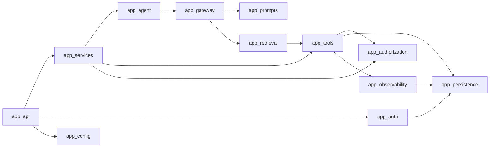

# Architecture

Orion is a modular monolith. Components communicate through explicit interfaces and dependency injection in `create_app()`.

Security trust boundaries and the final control-plane diagram live in
[security-architecture.md](security-architecture.md). Production phasing:
[prod-plan.md](../prod-plan.md).

## Module topology

## Modules

| Module | Responsibility |
| --- | --- |
| `app/api` | HTTP routes, middleware, rate limiting, auth dependencies |
| `app/auth` | Identity directory, signed JWT service, DevIdP, OIDC stub |
| `app/authorization` | Deny-by-default policy decisions |
| `app/config` | Environment loading and fail-closed production validation |
| `app/agent` | Bounded agent state machine and trajectory events |
| `app/gateway` | Model provider interface, FakeLLM, hosted/self-hosted stubs |
| `app/prompts` | Versioned prompt templates and content hashes |
| `app/retrieval` | Authorized retrieval metadata and search wrapper |
| `app/tools` | Tool definitions, registry, broker, implementations |
| `app/persistence` | SQLite schema and data access |
| `app/observability` | Structured security logs and redacted audit recording |
| `evals` | Deterministic evaluation datasets and runner |

## Request flow

1. Browser or API client presents a bearer JWT.
2. Token signature, issuer, audience, and expiry are verified.
3. Role and project membership are rebound from the server identity directory.
4. Route handlers call services/tools through the broker or orchestrator.
5. Authorization decisions are enforced again inside tool implementations.
6. Audit events are stored with redacted arguments and correlation IDs.

## Design decisions

- No microservices: the workload and deployment target do not justify them.
- FakeLLM remains the default deterministic provider for tests and local runs.
- Consequential tools never auto-execute; they create pending approvals.
- Retrieved document content is treated as untrusted data only.
