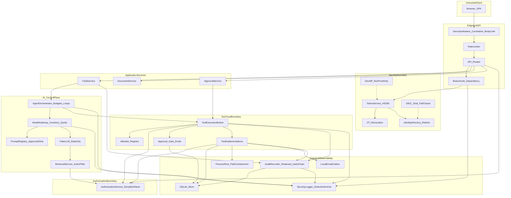
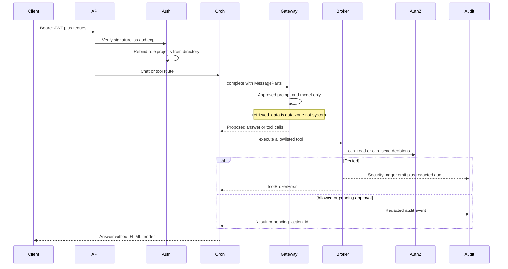

# Security Architecture

Final modular-monolith security design after the local hardening assessment.
Production sequencing beyond this baseline: [prod-plan.md](../prod-plan.md).

## Trust boundaries

1. **Browser / untrusted client** → API
2. **Authenticated principal** → authorization policy
3. **Model / FakeLLM proposals** → tool execution broker
4. **Retrieved documents** → model context as data only
5. **Fixture filesystem** → allowlisted paths under `data/fixtures`
6. **Production configuration** → fail closed when secrets/DevIdP are misconfigured

## Final architecture (security design)

### Trust-boundary callouts on the diagram

| Zone | Trusted for | Never trusted for |
| --- | --- | --- |
| UntrustedClient | Nothing security-critical | Roles, projects, tenant IDs, raw tokens as proof of authz |
| EdgeAndAPI | Transport limits, correlation, route wiring | Business authorization decisions |
| IdentityBoundary | Signature, iss/aud/exp, directory rebind | Client-embedded role claims |
| AuthorizationBoundary | Allow/deny decisions | Model or UI suggestions |
| AI_ControlPlane | Bounded inference and proposals | Executing tools or granting permissions |
| ToolTrustBoundary | Allowlist, schema, approval, execution | Document text as instructions |
| DataAndObservability | Persistence and detection telemetry | Storing raw secrets/chat bodies |

## Request path (security-relevant)

## Controls

- Signed HS256 JWTs with `iss`, `aud`, `exp`, `nbf`, `iat`, `jti`
- Server-side identity rebinding (client role claims ignored)
- DevIdP isolated to non-production with explicit enablement
- Central `AuthorizationService` for documents, customers, email, audit, approvals
- Tool allowlist, schema validation, approval for `send_email`
- Rate limiting on token and sensitive API paths
- Security response headers and CSP
- Redacted audit arguments, hash-chained audit rows, structured security logs
- Container non-root, read-only root filesystem, dropped capabilities

## Explicit non-claims

- FakeLLM document-instruction removal is not proof of real LLM robustness.
- Local fixture reads are not SSRF.
- SQLite outbox queuing is not external email delivery or exfiltration.
- This diagram describes the **assessed local architecture**; enterprise OIDC,
  shared rate limits, and real-model guardrails remain in [prod-plan.md](../prod-plan.md).
