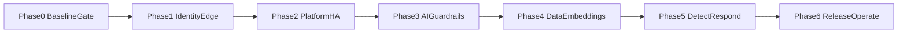

# Orion Production Security Plan

Phased recommendations for releasing and operating Orion beyond the local
security assessment. This document is a **program plan**, not proof that Orion
is production-ready today.

| | |
| --- | --- |
| Audience | AppSec, platform, AI engineering, and release owners |
| Current assessment posture | Hardened local/staging modular monolith (FakeLLM, SQLite, DevIdP) |
| Companion deploy-day switches | [docs/production-checklist.md](docs/production-checklist.md) |
| Known blockers | [docs/residual-risks.md](docs/residual-risks.md) |
| Local hardening evidence | [fixes.md](fixes.md) |

## How to use this plan

Each phase has:

- **Objective** — what risk the phase closes
- **Prerequisites** — what must already be true
- **Secure practices** — concrete controls to implement or operate
- **Acceptance criteria** — go / no-go evidence
- **Depends on** — prior phases

Do not skip phases that gate trust boundaries (identity, real-model enablement,
ingress). Parallel work inside a phase is fine when dependencies allow.

## Explicit non-claims

Local assessment work does **not** prove:

- Foundation-model prompt-injection resistance (FakeLLM only)
- Safe external email delivery (SQLite outbox only)
- SSRF defenses for arbitrary outbound HTTP (fixture fetch is local filesystem)
- Enterprise multi-tenant isolation (single-tenant `orion-local` + object ACLs)

---

## Phase 0 — Assessment baseline and go / no-go

**Objective:** Decide what may enter staging/prod based on evidence, not hope.

**Prerequisites:** Local hardening branch reviewed; regression suite green.

**Secure practices:**

1. Inventory controls as *implemented and tested*, *partial*, *external infra*,
   or *deferred* (see [docs/implementation-summary.md](docs/implementation-summary.md) §14).
2. Treat [docs/residual-risks.md](docs/residual-risks.md) as hard blockers until
   accepted with owner + expiry in [docs/accepted-risks.md](docs/accepted-risks.md).
3. Freeze unsafe config for any shared environment:
   - `ORION_ENV=production` (or equivalent non-dev)
   - `ORION_ENABLE_DEV_IDP=false`
   - `ORION_ALLOW_DATA_RESET` unset/false
   - FakeLLM remains default until Phase 3 acceptance

**Acceptance criteria:**

- [ ] Written go / no-go for public ingress and for non-fake model providers
- [ ] Residual risks assigned owners
- [ ] No production deploy while DevIdP or data-reset paths can enable

**Depends on:** None (starts from assessment).

**Hard stop:** Do not enable hosted/self-hosted models or public ingress until
Phase 1 and Phase 3 acceptance criteria are met.

---

## Phase 1 — Identity, secrets, and network edge

**Objective:** Only trusted identities reach Orion; secrets and TLS are not
improvised.

**Prerequisites:** Phase 0 go / no-go signed.

**Secure practices:**

### Real OIDC / enterprise IdP

- Configure live JWKS URL (or highly available JWKS path) with issuer and audience validation
- Map IdP `sub` / email claims to the server identity directory; **never** trust
  client-supplied roles or projects
- Document and test JWKS key rotation (overlap window, cache TTL, fail-closed on
  empty/unreachable JWKS)
- Replace the synthetic user picker with SSO UX; keep DevIdP impossible in production

### Secrets and session controls

- Store `ORION_TOKEN_SIGNING_KEY` (and IdP client secrets) in a secret manager
- Short production TTL; retain JTI revocation / logout
- Signing-key rotation runbook with dual-key verification window
- Fail closed when production signing key or OIDC config is missing

### Network edge

- Terminate TLS at a reverse proxy / ingress; do not publish the app container
  directly to the internet
- Restrict admin surfaces (`/api/audit`, `/api/outbox`, approvals) by network
  policy or identity group in addition to role checks
- Keep CORS explicit and minimal if a separate origin is introduced; if cookies
  are introduced later, add CSRF protections (current model uses bearer headers)

**Acceptance criteria:**

- [ ] Live OIDC login works against staging IdP; forged/wrong-aud/expired tokens rejected
- [ ] JWKS rotation drill documented and executed once
- [ ] DevIdP disabled and regression-tested in production config
- [ ] Secrets only from secret manager; no committed production keys
- [ ] Ingress TLS verified; admin paths network-restricted

**Depends on:** Phase 0.

---

## Phase 2 — Multi-instance platform hardening

**Objective:** Abuse and durability controls survive more than one process.

**Prerequisites:** Phase 1 identity and secrets in place.

**Secure practices:**

### Shared abuse controls

- Replace in-process rate limiting with a shared store (Redis or equivalent)
  covering token, chat, email, and approvals budgets
- Share tool idempotency keys and model per-user quotas across replicas
- Confirm JTI revocation remains correct when multiple app instances share the
  persistence layer

### Persistence and durability

- Decide: keep single-node SQLite with explicit SLA/failover **or** move to
  multi-writer-capable storage before horizontal scale
- Separate audit storage permissions from application write paths where possible
- Encrypt data volumes (KMS-backed disk encryption)
- Define RPO/RTO; run backup and restore drills on the data volume
- Retain DB file mode hardening (`0700` / `0600` patterns) and hash-chained audit

### Runtime / supply chain for the image

- Non-root UID, read-only root, dropped capabilities, no-new-privileges (retain
  current compose posture)
- Rebuild image from digest-pinned base; run container smoke (health, auth fail-closed)
- Retain SBOM + vulnerability scan gates before promoting an image tag

**Acceptance criteria:**

- [ ] Two+ app replicas cannot exceed combined rate budgets independently
- [ ] Duplicate side-effect tool calls collapse via shared idempotency
- [ ] Backup restore drill meets documented RPO/RTO
- [ ] Container smoke after digest-pinned rebuild passes
- [ ] Single-node SQLite limits are either accepted (owner + expiry) or replaced

**Depends on:** Phase 1.

---

## Phase 3 — AI guardrails (input, output, tools, real models)

**Objective:** Models and tools cannot silently escalate privilege or exfiltrate
data when a real provider is enabled.

**Prerequisites:** Phase 1 identity; Phase 2 budgets/idempotency if multi-instance.

**Secure practices:**

### Input moderation and prompt hygiene

- Enforce request size and schema bounds (retain body middleware + pydantic limits)
- Add input moderation for high-risk classes: credential dumping, social-engineering
  instructions to ignore policy, bulk PII paste — fail closed or require human review
- Keep system / developer / user / retrieved message-part separation; retrieved
  content must never become executable policy
- Version and approve prompts only through the prompt registry; release with content hashes

### Output moderation

- Scan model output for secrets, unexpected PII, and policy-violating content
  before returning to the client
- Never render untrusted HTML; keep `textContent` (or equivalent encoding)
- Strip or block tool-looking instructions in assistant text that could confuse
  downstream automation

### Tool and agent guardrails

- Keep centralized tool allowlist, argument validation, timeouts, and approval for
  consequential actions (`send_email` and any future write/external tools)
- Enforce approval separation of duties: requester ≠ approver (except break-glass
  with audit)
- Add cancellation for in-flight agent runs; retain step/tool/duration budgets and
  loop detection
- Models never decide authorization; broker + `AuthorizationService` remain the gate

### Real-model enablement gate

Before setting `ORION_MODEL_PROVIDER` to anything other than `fake`:

1. Run security evals for prompt injection, unsafe tool selection, groundedness,
   and sensitive-data disclosure against the **target** model/version
2. Record model inventory approval, prompt versions, and eval suite versions
3. Enable circuit breaker, retries, and output size limits in the model gateway
4. Keep FakeLLM regressions as unit tests; do not treat them as real-model proof

**Acceptance criteria:**

- [ ] Input and output moderation paths defined, tested, and owned
- [ ] Approval SoD enforced with regression tests
- [ ] Agent cancel path exists and is audited
- [ ] Real-model security eval suite green for the approved model ID/version
- [ ] Prompt change control + hash attestation recorded in release notes

**Depends on:** Phase 1 (required); Phase 2 (required for multi-instance).

---

## Phase 4 — Data protection and embedding / RAG security

**Objective:** Sensitive documents cannot cross identity boundaries via retrieval,
embeddings, logs, or email.

**Prerequisites:** Phase 3 guardrails if model-backed retrieval is user-facing.

**Secure practices:**

### Authorization before context

- Continue deny-by-default object-level checks before any document enters model
  context (classification + project + role)
- Prefer explicit deny telemetry for sensitive probes; avoid silent cross-tenant
  leakage even when filters omit results correctly

### Embedding and index protection (when introducing a vector store)

- Scope indexes by tenant / project; never share a flat global index across orgs
- Filter candidates by authorization **after** ANN retrieval and **before**
  promoting chunks to context (defense in depth)
- Version embedding model ID, distance metric, and retrieval config; pin in
  releases alongside prompt/model versions
- Protect embedding endpoints (authn, rate limits, no untrusted bulk embed of
  secrets); treat embedding output as sensitive derivative data
- Invalidate or re-embed on ACL or classification changes

### Ingestion and provenance

- Authenticate/authorize document ingestion; validate type, size, and path
- Retain provenance (source, classifier, project, ingest time) with each chunk
- Malware / content scanning for uploaded files before indexing

### Encryption, DLP, and logging

- TLS in transit; KMS encryption at rest for DB, object storage, and vector indexes
- If email leaves the local outbox: recipient policy, DLP, transport auth (SPF/DKIM/DMARC),
  and approval SoD from Phase 3
- Keep audit redaction; do not log full retrieved bodies or raw prompts by default

**Acceptance criteria:**

- [ ] Cross-user / cross-project retrieval tests pass against the production index design
- [ ] Embedding model + retrieval config versions recorded in telemetry
- [ ] Ingestion path authenticated with type/size validation
- [ ] Encryption at rest enabled for data and vector stores
- [ ] Real SMTP (if any) has DLP + allowlist + transport controls; otherwise outbox-only remains documented

**Depends on:** Phase 3 for model-backed RAG; Phase 1–2 for identity and storage.

---

## Phase 5 — Detection, response, and monitoring

**Objective:** Security-relevant behavior is visible, alertable, and actionable.

**Prerequisites:** Structured security logging from the assessment (see
[docs/detection-signals.md](docs/detection-signals.md) and [fixes.md](fixes.md)).

**Secure practices:**

- Ship JSON security events from stdout to a SIEM without embedding SIEM SDKs in-app
- Create alert rules for at least:
  - `authentication_failure` bursts
  - `token_issuance_anomaly` / `token_issuance_denied`
  - `cross_tenant_access_attempt`
  - `unauthorized_tool_attempt` / `unauthorized_resource_access`
  - `unusual_email_recipient`
  - `path_policy`
  - `agent_loop_detected` / `excessive_tool_calls` / `tool_timeout`
  - `abnormal_model_usage`
- Correlate API → agent → tool → authz using `correlation_id`
- On-call ownership for pending approvals and audit review
- Incident runbooks: credential stuffing, IDOR probing, prompt/tool abuse,
  fixture/path escape attempts, approval misuse

**Acceptance criteria:**

- [ ] SIEM receives events from staging/prod with correlation IDs intact
- [ ] Alert rules tuned with owners and severity
- [ ] Tabletop or drill for one high-severity signal (e.g. unusual email or IDOR)
- [ ] Approval/audit on-call documented

**Depends on:** Phases 1–4 controls that generate meaningful signals.

---

## Phase 6 — Release gates and steady-state operations

**Objective:** Every production change is evidence-backed and reversible.

**Prerequisites:** Phases 1–5 acceptance for the intended release tier
(see matrices below).

**Secure practices:**

### Release gates

- Hosted CI must produce artifacts for SAST, SCA, secrets, container, IaC, SBOM;
  fail closed (no `continue-on-error` without accepted risk)
- Lockfile drift check vs `pyproject.toml`; Dependabot review cadence
- Security regression tests + AI eval suite required for merge/release
- Production config fail-closed verification in pipeline (missing key / DevIdP on → fail)
- Staged rollout (canary/staging → prod) with rollback for image, prompt, and model version

### Steady-state operations

- Runbooks: signing-key rotation, IdP outage, IR, model/prompt rollback, data restore
- Periodic access review for manager/admin roles and approval privileges
- Accepted-risk register with owners and expiry ([docs/accepted-risks.md](docs/accepted-risks.md))
- Re-run real-model security evals when model, prompt, tools, or retrieval config change

**Day-of switches:** execute [docs/production-checklist.md](docs/production-checklist.md)
only after the matching phase acceptance criteria above are green.

**Acceptance criteria:**

- [ ] Latest release has hosted CI security artifacts retained
- [ ] Rollback drill completed once per quarter (or before first prod cutover)
- [ ] Ops runbooks published and linked from on-call docs
- [ ] No open residual risk without owner + expiry

**Depends on:** Phases 0–5 according to release tier.

---

## Minimum viable production vs enterprise hardened

| Capability | Minimum viable production (internal) | Enterprise hardened |
| --- | --- | --- |
| Identity | Phase 1 OIDC + DevIdP off | + SSO UX, JWKS rotation drills, admin network policy |
| Scale | Single node OK if accepted | Phase 2 shared limiter/idempotency + HA data store |
| Model | FakeLLM or tightly gated internal model after Phase 3 evals | Continuous evals, output moderation, inventory change control |
| Data / RAG | Keyword/ACL path + encryption at rest | Phase 4 vector scoping, ingest pipeline, re-embed on ACL change |
| Email | Local outbox only | Real SMTP + DLP + SoD approvals |
| Detect / ops | Phase 5 SIEM + Phase 6 runbooks | Tuned detections, IR drills, access reviews |

**Unlock order:**

- Internal dogfood behind SSO: complete Phases 0–1, partial 5–6
- Multi-instance or customer data: add Phase 2 and Phase 4
- Any non-fake model: Phase 3 acceptance is mandatory
- External email or public API: full Phases 3–6

---

## Recommendation → current Orion status

| Recommendation area | Current status |
| --- | --- |
| Signed JWT + claim rebinding | Done locally (tested) |
| DevIdP production fail-closed | Done locally (tested) |
| Central authz + customer OLAC | Done locally (tested) |
| Tool broker, allowlist, email approval | Done locally (tested); SoD not enforced |
| FakeLLM data-only retrieval handling | Done locally (tested) |
| Fixture path containment | Done locally (tested) |
| Structured detection logging catalogue | Done locally (tested); SIEM shipping not started |
| In-process rate limit / body caps | Done locally; shared limiter not started |
| Prompt registry + message-part separation | Done locally |
| Model gateway inventory / breaker / quotas | Done locally (in-process quotas) |
| Digest-pinned image + compose hardening | Done in source; runtime smoke deferred |
| CI security workflow definition | Done in source; hosted runner artifacts deferred |
| Live OIDC / JWKS rotation | Needs external infrastructure |
| Frontend SSO | Not started |
| Shared Redis (or equiv.) limiter / idempotency | Not started |
| Approval requester ≠ approver | Not started |
| Agent cancellation API | Not started |
| Input / output moderation services | Not started (size/schema bounds only) |
| Real-model security eval gate | Deferred until non-fake provider |
| Vector DB tenant scoping / embedding protection | N/A today (keyword retrieval); required when embeddings land |
| Real SMTP + DLP | N/A (outbox only) |
| Secret manager + key rotation runbook | Partial (config fail-closed); ops runbook thin |
| Backup / restore drill | Not started |
| Separate audit DB permissions | Deferred |

---

## 30 / 60 / 90-day adoption sketch

### Days 0–30 (foundation)

- Phase 0 go / no-go and residual-risk owners
- Phase 1 OIDC staging + secret manager + TLS ingress
- Phase 5 log shipping (even if alert tuning is rough)
- Phase 6: ensure hosted CI artifacts exist for the release branch

### Days 31–60 (scale and AI readiness)

- Phase 2 shared rate limit / idempotency if more than one replica
- Backup restore drill; encryption at rest confirmation
- Phase 3 input/output moderation design + approval SoD + real-model eval harness
- Do **not** flip production to a hosted model until evals pass

### Days 61–90 (data plane and harden)

- Phase 4 ingestion + embedding/index design if RAG moves beyond keyword SQLite
- Phase 5 alert tuning and IR tabletop
- Phase 6 runbooks, rollback drill, access review
- Re-classify residual risks; accept only with owner + expiry

---

## Related documents

- [docs/production-checklist.md](docs/production-checklist.md) — day-of deploy switches
- [docs/residual-risks.md](docs/residual-risks.md) — current blockers
- [docs/security-architecture.md](docs/security-architecture.md) — trust boundaries
- [docs/authn-authz.md](docs/authn-authz.md) — identity model
- [docs/model-gateway.md](docs/model-gateway.md) — inference controls
- [docs/rag-security.md](docs/rag-security.md) — retrieval posture
- [docs/agent-tools.md](docs/agent-tools.md) — tool broker
- [docs/detection-signals.md](docs/detection-signals.md) — SIEM signal catalogue
- [docs/cicd-security.md](docs/cicd-security.md) — pipeline gates
- [docs/docker-hardening.md](docs/docker-hardening.md) — container posture
- [docs/accepted-risks.md](docs/accepted-risks.md) — exception register
- [fixes.md](fixes.md) — what the local assessment already changed
- [to-do.md](to-do.md) — deferred engineering backlog
